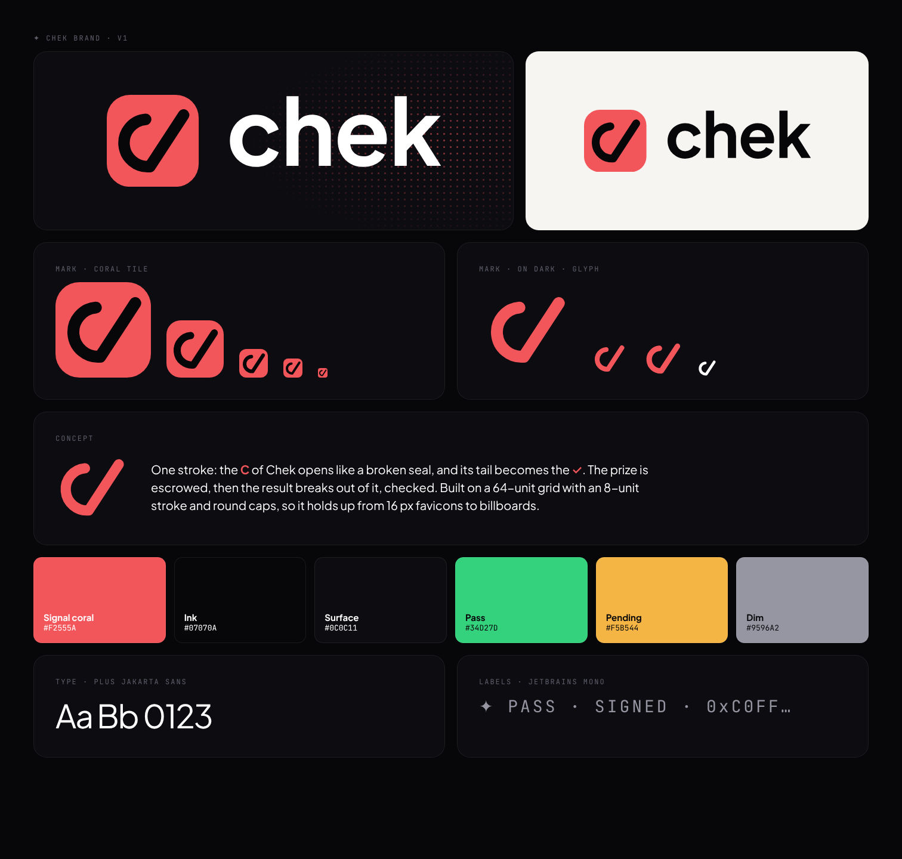

# Chek brand

## The mark

One stroke: the **C** of Chek opens like a broken seal, and its tail becomes the **✓**. The prize is escrowed,
then the result breaks out of it, checked.

Geometry, on a 64-unit grid (the files in `packages/web/public/brand/` are the source of truth):

- Tile: 64 × 64, corner radius 16, Signal coral `#F2555A`.
- Stroke: 8 units, round caps and joins, Ink `#07070A`.
- The C is an arc of radius 16.5 around (28.5, 33.5), from −95° (just left of 12 o'clock, so the C stays
  clearly open and never reads as a "d") round to 85°. It then runs into the check's corner at (30, 50) and
  rises to (53.5, 14), leaving through the C's opening.

Tested at 16, 24 and 32 px, where it reads as a check in a box.

## Wordmark and lockup

- "chek", lowercase, set in Plus Jakarta Sans 700 with −14 tracking and outlined to paths. It never depends on
  a web font.
- Lockup: the tile, then a gap of 0.3 × the tile height, then the wordmark at the tile's scale (1000 font
  units = tile height), with its x-height centred on the tile.
- In the app the lockup is `<Logo height={…} />` and the mark alone is `<Mark size={…} />`
  (`packages/web/src/components/ui.tsx`), drawn from the same paths in `brand-paths.ts`.

A logotype with the C-check standing in for the "c" was tried and rejected: inside a word, a bowl with a tall
stroke on its right reads as "dhek".

## Files

| File | Use |
| --- | --- |
| `public/brand/chek-mark.svg` | App icon, avatars, the default mark |
| `public/brand/chek-mark-dark.svg` | Mark on dark surfaces (coral stroke, dark tile) |
| `public/brand/chek-glyph.svg` | Stroke only, `currentColor`, for monochrome and inline use |
| `public/brand/chek-lockup-dark-bg.svg` / `-light-bg.svg` | Mark + wordmark for dark and light backgrounds |
| `public/brand/chek-wordmark.svg` | Wordmark only, `currentColor` |
| `public/favicon.svg`, `favicon-32.png`, `apple-touch-icon.png`, `icon-512.png` | Browser and home-screen icons |
| `public/og-image.png` | Social card (1200 × 630) |

## Colour

| Name | Hex | Use |
| --- | --- | --- |
| Signal coral | `#F2555A` | Brand, primary actions, live/open |
| Ink | `#07070A` | Background, the mark's stroke |
| Surface | `#0C0C11` | Cards and panels |
| Pass | `#34D27D` | Checks that passed, confirmed payouts |
| Pending | `#F5B544` | Waiting states |
| Dim | `#9596A2` | Secondary text |

## Type

Plus Jakarta Sans for text and headings; JetBrains Mono for labels, IDs and status words (uppercase, wide
tracking). Both are OFL and bundled with the app.

## Don't

- Don't close the C or move the check inside it: it turns into a "d".
- Don't recolour the tile anything but coral, or put the coral tile on a coral background.
- Don't set "Chek" in another typeface as a logo; use the outlined wordmark.
